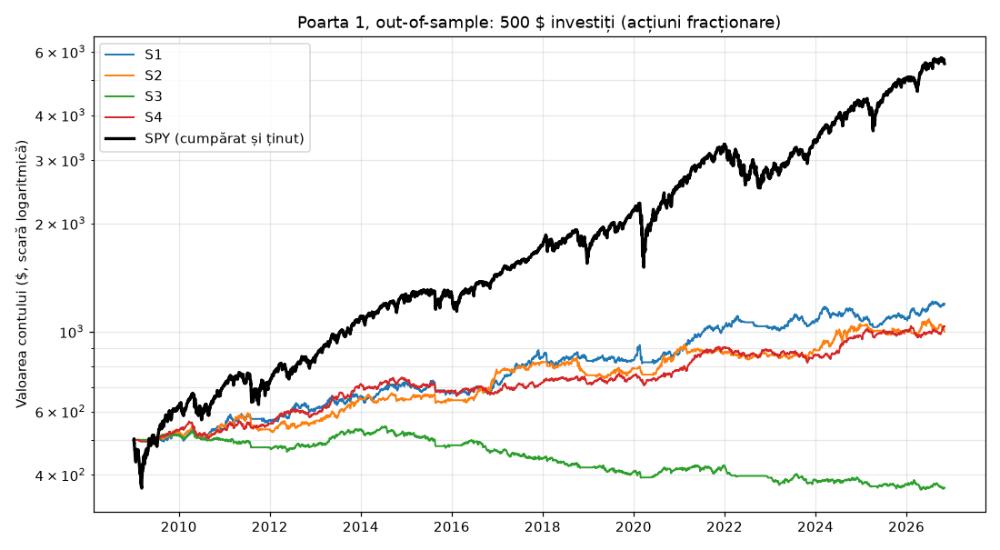
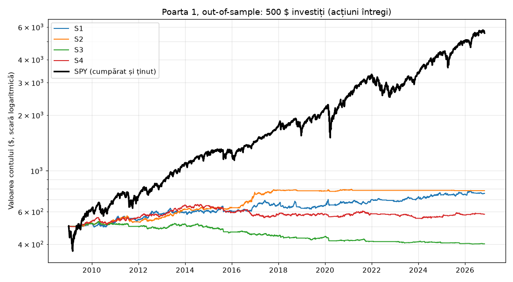

# Poarta 1: rezultatul backtestului

2026-11-03 · Claude Code · etapa 3b · generat de `scripts/gate1.py`

## Pe scurt

**Nicio strategie nu trece Poarta 1, în niciuna dintre variante.** Conform planului (D7), nu trecem la bani, nici la paper trading cu aceste strategii.

- Acțiuni fracționare, S1 Trend Breakout: **FAIL (criteriile 2, 6)**
- Acțiuni fracționare, S2 Momentum Rotation: **FAIL (criteriile 2, 4, 6)**
- Acțiuni fracționare, S3 RSI-2 Pullback: **FAIL (criteriile 2, 3, 4, 5, 7)**
- Acțiuni fracționare, S4 MACD + EMA200: **FAIL (criteriile 2, 6)**
- Acțiuni întregi, S1 Trend Breakout: **FAIL (criteriile 2, 6)**
- Acțiuni întregi, S2 Momentum Rotation: **FAIL (criteriile 2, 4, 6)**
- Acțiuni întregi, S3 RSI-2 Pullback: **FAIL (criteriile 2, 3, 4, 5, 7)**
- Acțiuni întregi, S4 MACD + EMA200: **FAIL (criteriile 2, 3, 5, 6)**

## Pe înțeles

Cu 500 $ puși la începutul lui 2009 (acțiuni fracționare), la final aveai: S1 1,195 $, S2 1,000 $, S3 368 $, S4 1,035 $; SPY cumpărat și ținut: **5,563 $**. Cea mai bună strategie (S1) a câștigat 5.0% pe an, SPY 14.5% pe an. Strategiile au pierderi mai mici (drawdown), dar și ajustat la risc (Sharpe) rămân sub SPY. Testul cu intrări aleatoare arată că, la S1, S2, S4, alegerea momentului de intrare nu aduce mare lucru față de intrări la întâmplare cu aceleași ieșiri și stopuri.

## Cum s-a testat

- Date: 101 acțiuni din `config/universe.csv` (S&P 100) și SPY, zilnic, 2006-01-03 – 2026-11-02, prețuri ajustate cu dividende și split-uri (yfinance).
- Out-of-sample (OOS): walk-forward cu 3 ani de istoric înaintea fiecărei ferestre de test de 1 an; OOS = 2009-01-05 – 2026-11-02 (18 ferestre). Fiecare fereastră pornește cu capitalul inițial; curba OOS înlănțuie ferestrele (D10).
- Parametrii sunt cei din `config/strategies.yaml`, aceiași în toate ferestrele, neoptimizați.
- Costuri pe fiecare parte: slippage 0.10% + jumătate de spread 0.05%; comision 0.
- Capital 500 $; risc 0.5% din cont pe tranzacție; maximum 20% din cont pe o poziție, 5 poziții, 2 pe sector; fără levier.
- SPY: cumpărat la începutul perioadei OOS și ținut până la final, cu aceleași costuri.
- Monte Carlo: 1000 de reamestecări ale ordinii tranzacțiilor OOS. Intrări aleatoare: 500 de rulări pe perioada OOS (aceleași ieșiri, stopuri și sizing), comparate după Sharpe. Testul ±20%: fiecare parametru pe rând, restul la bază (D17).

## Rezultate: acțiuni fracționare

| | S1 | S2 | S3 | S4 | SPY |
|---|---|---|---|---|---|
| Tranzacții OOS | 526 | 291 | 3890 | 884 | 1 |
| Randament total | +138.9% | +100.0% | -26.4% | +106.9% | +1012.6% |
| CAGR (pe an) | +5.0% | +4.0% | -1.7% | +4.2% | +14.5% |
| Sharpe | 0.69 | 0.60 | -0.32 | 0.75 | 0.85 |
| Drawdown maxim | 12.2% | 12.6% | 33.4% | 11.2% | 33.7% |
| Profit factor | 1.66 | 1.87 | 0.91 | 1.33 | - |
| Expectancy (R) | +0.35 | +0.52 | -0.01 | +0.17 | - |
| Tranzacții câștigătoare | 42.0% | 40.2% | 59.7% | 49.1% | - |
| Expunere medie | 47.5% | 25.5% | 26.6% | 35.2% | 100% |
| Ferestre profitabile | 77.8% | 55.6% | 27.8% | 72.2% | - |
| MC drawdown p95 | 11.7% | 11.6% | 33.1% | 12.0% | - |
| Bate intrările aleatoare | 33.4% | 44.8% | 100.0% | 70.8% | - |
| PF minim la ±20% | 1.49 | 1.82 | 0.80 | 1.21 | - |
| **Verdict** | **FAIL** | **FAIL** | **FAIL** | **FAIL** | - |

Criteriile, pe rând:

| # | Criteriu | S1 | S2 | S3 | S4 |
|---|---|---|---|---|---|
| 1 | Tranzacții OOS (>= 150) | ✅ 526 | ✅ 773 poziții-lună (291 tranzacții) | ✅ 3890 | ✅ 884 |
| 2 | Mai bună decât SPY ajustat la risc (Sharpe >= 1.05, sau CAGR >= 14.5% și DD <= 23.6%) | ❌ Sharpe 0.69 vs 0.85; CAGR 5.0% vs 14.5%; DD 12.2% vs 33.7% | ❌ Sharpe 0.60 vs 0.85; CAGR 4.0% vs 14.5%; DD 12.6% vs 33.7% | ❌ Sharpe -0.32 vs 0.85; CAGR -1.7% vs 14.5%; DD 33.4% vs 33.7% | ❌ Sharpe 0.75 vs 0.85; CAGR 4.2% vs 14.5%; DD 11.2% vs 33.7% |
| 3 | Profit factor și expectancy (PF >= 1.3, expectancy >= +0.1R) | ✅ PF 1.66; expectancy +0.35R | ✅ PF 1.87; expectancy +0.52R | ❌ PF 0.91; expectancy -0.01R | ✅ PF 1.33; expectancy +0.17R |
| 4 | Ferestre walk-forward profitabile (>= 60%) | ✅ 77.8% | ❌ 55.6% | ❌ 27.8% | ✅ 72.2% |
| 5 | Parametri la ±20% (PF > 1.1 în toate) | ✅ PF minim 1.49 din 10 variante | ✅ PF minim 1.82 din 14 variante | ❌ PF minim 0.80 din 14 variante | ✅ PF minim 1.21 din 16 variante |
| 6 | Bate intrările aleatoare (>= 95%) | ❌ 33.4% din rulări (după Sharpe) | ❌ 44.8% din rulări (după Sharpe) | ✅ 100.0% din rulări (după Sharpe) | ❌ 70.8% din rulări (după Sharpe) |
| 7 | Monte Carlo: drawdown p95 (< 20%) | ✅ 11.7% | ✅ 11.6% | ❌ 33.1% | ✅ 12.0% |

## Rezultate: acțiuni întregi

| | S1 | S2 | S3 | S4 | SPY |
|---|---|---|---|---|---|
| Tranzacții OOS | 484 | 109 | 2223 | 721 | 1 |
| Randament total | +51.0% | +56.1% | -19.6% | +16.3% | +1012.6% |
| CAGR (pe an) | +2.3% | +2.5% | -1.2% | +0.9% | +14.5% |
| Sharpe | 0.45 | 0.74 | -0.39 | 0.23 | 0.85 |
| Drawdown maxim | 10.4% | 8.1% | 24.5% | 16.2% | 33.7% |
| Profit factor | 1.40 | 2.99 | 0.86 | 1.10 | - |
| Expectancy (R) | +0.23 | +0.99 | -0.02 | +0.06 | - |
| Tranzacții câștigătoare | 37.8% | 46.8% | 59.3% | 46.0% | - |
| Expunere medie | 34.1% | 9.7% | 13.3% | 22.9% | 100% |
| Ferestre profitabile | 83.3% | 50.0% | 16.7% | 61.1% | - |
| MC drawdown p95 | 12.2% | 5.1% | 24.0% | 15.4% | - |
| Bate intrările aleatoare | 10.2% | 71.6% | 100.0% | 27.0% | - |
| PF minim la ±20% | 1.35 | 2.74 | 0.81 | 1.08 | - |
| **Verdict** | **FAIL** | **FAIL** | **FAIL** | **FAIL** | - |

Criteriile, pe rând:

| # | Criteriu | S1 | S2 | S3 | S4 |
|---|---|---|---|---|---|
| 1 | Tranzacții OOS (>= 150) | ✅ 484 | ✅ 338 poziții-lună (109 tranzacții) | ✅ 2223 | ✅ 721 |
| 2 | Mai bună decât SPY ajustat la risc (Sharpe >= 1.05, sau CAGR >= 14.5% și DD <= 23.6%) | ❌ Sharpe 0.45 vs 0.85; CAGR 2.3% vs 14.5%; DD 10.4% vs 33.7% | ❌ Sharpe 0.74 vs 0.85; CAGR 2.5% vs 14.5%; DD 8.1% vs 33.7% | ❌ Sharpe -0.39 vs 0.85; CAGR -1.2% vs 14.5%; DD 24.5% vs 33.7% | ❌ Sharpe 0.23 vs 0.85; CAGR 0.9% vs 14.5%; DD 16.2% vs 33.7% |
| 3 | Profit factor și expectancy (PF >= 1.3, expectancy >= +0.1R) | ✅ PF 1.40; expectancy +0.23R | ✅ PF 2.99; expectancy +0.99R | ❌ PF 0.86; expectancy -0.02R | ❌ PF 1.10; expectancy +0.06R |
| 4 | Ferestre walk-forward profitabile (>= 60%) | ✅ 83.3% | ❌ 50.0% | ❌ 16.7% | ✅ 61.1% |
| 5 | Parametri la ±20% (PF > 1.1 în toate) | ✅ PF minim 1.35 din 10 variante | ✅ PF minim 2.74 din 14 variante | ❌ PF minim 0.81 din 14 variante | ❌ PF minim 1.08 din 16 variante |
| 6 | Bate intrările aleatoare (>= 95%) | ❌ 10.2% din rulări (după Sharpe) | ❌ 71.6% din rulări (după Sharpe) | ✅ 100.0% din rulări (după Sharpe) | ❌ 27.0% din rulări (după Sharpe) |
| 7 | Monte Carlo: drawdown p95 (< 20%) | ✅ 12.2% | ✅ 5.1% | ❌ 24.0% | ✅ 15.4% |

Intrări respinse pentru că nici o acțiune întreagă nu încăpea în risc sau în plafonul de poziție (backtest continuu pe perioada OOS): S1 1255, S2 361, S3 11165, S4 1253.

## Testul ±20% în detaliu

Acțiuni fracționare

| Strategie | Parametru | Bază | Variantă | PF | Tranzacții | Sharpe |
|---|---|---|---|---|---|---|
| S1 | sma_filter | 200 | 160 | 1.74 | 521 | 0.77 |
| S1 | sma_filter | 200 | 240 | 1.70 | 526 | 0.74 |
| S1 | entry_lookback | 55 | 44 | 1.65 | 527 | 0.67 |
| S1 | entry_lookback | 55 | 66 | 1.66 | 524 | 0.68 |
| S1 | exit_lookback | 20 | 16 | 1.49 | 594 | 0.60 |
| S1 | exit_lookback | 20 | 24 | 1.64 | 489 | 0.65 |
| S1 | atr_period | 20 | 16 | 1.61 | 530 | 0.66 |
| S1 | atr_period | 20 | 24 | 1.63 | 533 | 0.68 |
| S1 | stop_atr | 2.5 | 2 | 1.59 | 598 | 0.68 |
| S1 | stop_atr | 2.5 | 3 | 1.53 | 498 | 0.58 |
| S2 | momentum_lookback | 252 | 202 | 2.01 | 323 | 0.70 |
| S2 | momentum_lookback | 252 | 302 | 2.29 | 281 | 0.79 |
| S2 | momentum_skip | 21 | 17 | 2.04 | 284 | 0.67 |
| S2 | momentum_skip | 21 | 25 | 1.94 | 305 | 0.67 |
| S2 | sma_filter | 200 | 160 | 1.89 | 297 | 0.62 |
| S2 | sma_filter | 200 | 240 | 1.96 | 285 | 0.63 |
| S2 | top_n | 5 | 4 | 2.11 | 253 | 0.69 |
| S2 | top_n | 5 | 6 | 1.82 | 307 | 0.59 |
| S2 | exit_rank | 10 | 8 | 1.98 | 309 | 0.67 |
| S2 | exit_rank | 10 | 12 | 2.09 | 269 | 0.68 |
| S2 | atr_period | 20 | 16 | 1.89 | 289 | 0.61 |
| S2 | atr_period | 20 | 24 | 1.90 | 288 | 0.61 |
| S2 | stop_atr | 3 | 2.4 | 1.84 | 315 | 0.59 |
| S2 | stop_atr | 3 | 3.6 | 1.93 | 270 | 0.62 |
| S3 | sma_filter | 200 | 160 | 0.94 ❌ | 3815 | -0.22 |
| S3 | sma_filter | 200 | 240 | 0.91 ❌ | 3936 | -0.32 |
| S3 | rsi_period | 2 | 1 | 0.80 ❌ | 7453 | -0.97 |
| S3 | rsi_period | 2 | 3 | 1.04 ❌ | 2114 | 0.12 |
| S3 | rsi_entry | 10 | 8 | 0.91 ❌ | 3515 | -0.30 |
| S3 | rsi_entry | 10 | 12 | 0.93 ❌ | 4166 | -0.26 |
| S3 | exit_sma | 5 | 4 | 0.88 ❌ | 4385 | -0.43 |
| S3 | exit_sma | 5 | 6 | 0.94 ❌ | 3504 | -0.20 |
| S3 | max_hold_bars | 10 | 8 | 0.91 ❌ | 3936 | -0.32 |
| S3 | max_hold_bars | 10 | 12 | 0.91 ❌ | 3877 | -0.33 |
| S3 | atr_period | 20 | 16 | 0.91 ❌ | 3886 | -0.32 |
| S3 | atr_period | 20 | 24 | 0.90 ❌ | 3895 | -0.35 |
| S3 | stop_atr | 3 | 2.4 | 0.88 ❌ | 4081 | -0.44 |
| S3 | stop_atr | 3 | 3.6 | 0.93 ❌ | 3798 | -0.22 |
| S4 | ema_filter | 200 | 160 | 1.33 | 848 | 0.71 |
| S4 | ema_filter | 200 | 240 | 1.38 | 895 | 0.84 |
| S4 | macd_fast | 12 | 10 | 1.24 | 903 | 0.55 |
| S4 | macd_fast | 12 | 14 | 1.40 | 851 | 0.87 |
| S4 | macd_slow | 26 | 21 | 1.25 | 934 | 0.57 |
| S4 | macd_slow | 26 | 31 | 1.45 | 840 | 0.94 |
| S4 | macd_signal | 9 | 7 | 1.28 | 906 | 0.64 |
| S4 | macd_signal | 9 | 11 | 1.40 | 834 | 0.84 |
| S4 | swing_lookback | 10 | 8 | 1.33 | 927 | 0.74 |
| S4 | swing_lookback | 10 | 12 | 1.30 | 863 | 0.68 |
| S4 | atr_period | 20 | 16 | 1.35 | 882 | 0.78 |
| S4 | atr_period | 20 | 24 | 1.38 | 884 | 0.83 |
| S4 | min_stop_atr | 1.5 | 1.2 | 1.32 | 887 | 0.73 |
| S4 | min_stop_atr | 1.5 | 1.8 | 1.36 | 863 | 0.80 |
| S4 | target_r | 1.5 | 1.2 | 1.21 | 1000 | 0.51 |
| S4 | target_r | 1.5 | 1.8 | 1.38 | 768 | 0.77 |

Acțiuni întregi

| Strategie | Parametru | Bază | Variantă | PF | Tranzacții | Sharpe |
|---|---|---|---|---|---|---|
| S1 | sma_filter | 200 | 160 | 1.51 | 472 | 0.55 |
| S1 | sma_filter | 200 | 240 | 1.42 | 473 | 0.47 |
| S1 | entry_lookback | 55 | 44 | 1.45 | 487 | 0.50 |
| S1 | entry_lookback | 55 | 66 | 1.51 | 467 | 0.54 |
| S1 | exit_lookback | 20 | 16 | 1.43 | 529 | 0.50 |
| S1 | exit_lookback | 20 | 24 | 1.77 | 435 | 0.71 |
| S1 | atr_period | 20 | 16 | 1.45 | 474 | 0.48 |
| S1 | atr_period | 20 | 24 | 1.35 | 486 | 0.40 |
| S1 | stop_atr | 2.5 | 2 | 1.84 | 538 | 0.87 |
| S1 | stop_atr | 2.5 | 3 | 1.64 | 403 | 0.60 |
| S2 | momentum_lookback | 252 | 202 | 3.38 | 114 | 0.84 |
| S2 | momentum_lookback | 252 | 302 | 3.99 | 107 | 0.91 |
| S2 | momentum_skip | 21 | 17 | 3.49 | 104 | 0.80 |
| S2 | momentum_skip | 21 | 25 | 3.51 | 110 | 0.84 |
| S2 | sma_filter | 200 | 160 | 2.83 | 111 | 0.72 |
| S2 | sma_filter | 200 | 240 | 2.74 | 113 | 0.70 |
| S2 | top_n | 5 | 4 | 3.54 | 91 | 0.80 |
| S2 | top_n | 5 | 6 | 2.87 | 126 | 0.74 |
| S2 | exit_rank | 10 | 8 | 3.07 | 113 | 0.78 |
| S2 | exit_rank | 10 | 12 | 3.66 | 102 | 0.82 |
| S2 | atr_period | 20 | 16 | 2.93 | 110 | 0.74 |
| S2 | atr_period | 20 | 24 | 3.09 | 108 | 0.76 |
| S2 | stop_atr | 3 | 2.4 | 2.83 | 129 | 0.72 |
| S2 | stop_atr | 3 | 3.6 | 3.27 | 88 | 0.78 |
| S3 | sma_filter | 200 | 160 | 0.90 ❌ | 2158 | -0.28 |
| S3 | sma_filter | 200 | 240 | 0.85 ❌ | 2249 | -0.41 |
| S3 | rsi_period | 2 | 1 | 0.81 ❌ | 5955 | -0.85 |
| S3 | rsi_period | 2 | 3 | 1.18 | 1053 | 0.30 |
| S3 | rsi_entry | 10 | 8 | 0.88 ❌ | 1938 | -0.31 |
| S3 | rsi_entry | 10 | 12 | 0.87 ❌ | 2469 | -0.39 |
| S3 | exit_sma | 5 | 4 | 0.87 ❌ | 2410 | -0.37 |
| S3 | exit_sma | 5 | 6 | 0.88 ❌ | 2055 | -0.32 |
| S3 | max_hold_bars | 10 | 8 | 0.86 ❌ | 2244 | -0.39 |
| S3 | max_hold_bars | 10 | 12 | 0.86 ❌ | 2218 | -0.39 |
| S3 | atr_period | 20 | 16 | 0.87 ❌ | 2235 | -0.34 |
| S3 | atr_period | 20 | 24 | 0.85 ❌ | 2224 | -0.40 |
| S3 | stop_atr | 3 | 2.4 | 0.84 ❌ | 2666 | -0.51 |
| S3 | stop_atr | 3 | 3.6 | 0.89 ❌ | 1933 | -0.28 |
| S4 | ema_filter | 200 | 160 | 1.23 | 707 | 0.47 |
| S4 | ema_filter | 200 | 240 | 1.12 | 746 | 0.28 |
| S4 | macd_fast | 12 | 10 | 1.22 | 749 | 0.47 |
| S4 | macd_fast | 12 | 14 | 1.21 | 672 | 0.45 |
| S4 | macd_slow | 26 | 21 | 1.28 | 753 | 0.59 |
| S4 | macd_slow | 26 | 31 | 1.32 | 661 | 0.65 |
| S4 | macd_signal | 9 | 7 | 1.23 | 765 | 0.50 |
| S4 | macd_signal | 9 | 11 | 1.32 | 657 | 0.64 |
| S4 | swing_lookback | 10 | 8 | 1.13 | 741 | 0.30 |
| S4 | swing_lookback | 10 | 12 | 1.08 ❌ | 706 | 0.18 |
| S4 | atr_period | 20 | 16 | 1.10 | 724 | 0.22 |
| S4 | atr_period | 20 | 24 | 1.10 | 718 | 0.23 |
| S4 | min_stop_atr | 1.5 | 1.2 | 1.10 ❌ | 733 | 0.22 |
| S4 | min_stop_atr | 1.5 | 1.8 | 1.17 | 687 | 0.36 |
| S4 | target_r | 1.5 | 1.2 | 1.13 | 759 | 0.28 |
| S4 | target_r | 1.5 | 1.8 | 1.30 | 638 | 0.58 |

## Note și limite

- **Survivorship bias.** Universul este lista S&P 100 de azi, aplicată pe tot istoricul. Firmele care au ieșit din indice sau au dat faliment lipsesc, iar cele ajunse azi în S&P 100 (deci câștigătoarele) sunt incluse din 2006. Rezultatele strategiilor sunt astfel mai bune decât ar fi fost în realitate, mai ales la momentum și breakout. Un FAIL e sigur; un PASS ar trebui privit cu prudență.
- Acțiuni listate după începutul datelor: ABBV (2013), AVGO (2009), CHTR (2010), DOW (2019), GM (2010), KHC (2015), MA (2006), META (2012), PM (2008), PYPL (2015), TMUS (2007), TSLA (2010), V (2008). Ele apar doar de la listare.
- **Sharpe nu depinde de cât din cont e investit** (rata fără risc 0), deci comparația cu SPY e corectă chiar dacă strategiile stau mult în cash. CAGR-ul mic vine și din riscul de 0.5% pe tranzacție.
- **Acțiuni întregi:** prețurile istorice sunt ajustate pentru split-uri, deci în trecut acțiunile par mai ieftine decât au fost (de exemplu AAPL), iar varianta e optimistă. Azi, la 500 $ cu maximum 100 $ pe poziție, doar 25 din 101 acțiuni costă cel mult 100 $.
- OOS începe în 2009: criza din 2008 e doar în istoricul primei ferestre, nu în OOS.
- S2: criteriul 1 numără poziții-lună (o poziție ținută peste un sfârșit de lună = 1, minimum 1).
- Criteriul 6 cere Sharpe-ul strategiei peste 95% din rulările aleatoare; criteriul 7 cere drawdown-ul p95 sub 20%. Regulile de evaluare au fost fixate înaintea rulării complete (D17). Verdictul nu depinde de măsura aleasă la criteriul 6: toate strategiile pică oricum criteriul 2.

## Ce urmează

Planul spune: dacă nicio strategie nu trece, ne oprim. Parametrii **nu** se ajustează ca să treacă (interdicția 6). Decizia e a proprietarului: fie oprim proiectul aici (D7), fie aprobă o iterație documentată (maximum 2 per strategie), cu motivul scris în `docs/DECISIONS.md` înainte de rulare, nu după ce vedem rezultatele.
