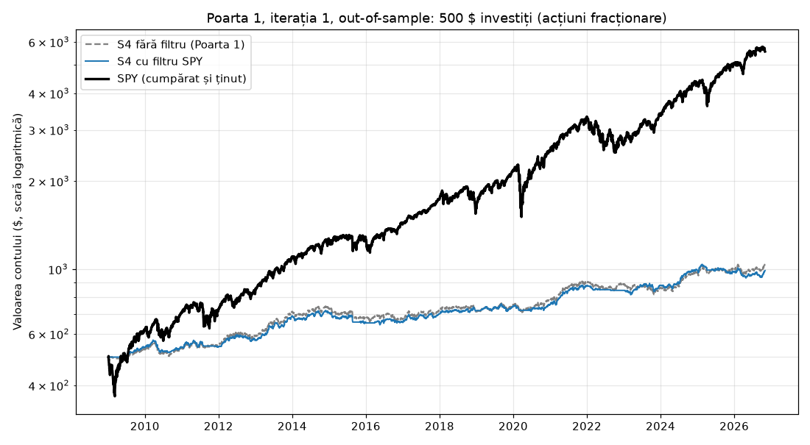
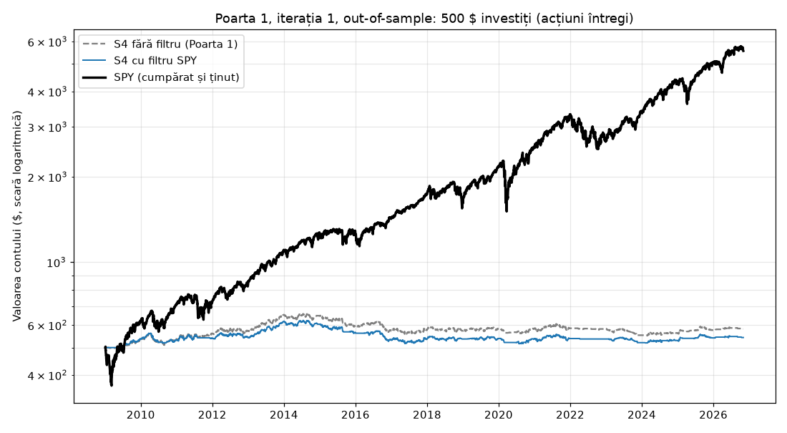

# Poarta 1, iterația 1: S4 cu filtrul SPY

2026-11-03 · Claude Code · etapa 3c · generat de `scripts/gate1.py --iteratia1`

## Pe scurt

O singură schimbare (D18): S4 MACD + EMA200 intră doar când și piața urcă, adică SPY e peste media lui pe 200 de zile (SMA200), ca la S1, S2 și S3. Restul regulilor, datele, cele 7 criterii și pragurile sunt aceleași ca la Poarta 1 de bază (`reports/gate1.md`).

- Acțiuni fracționare: **FAIL (criteriile 2, 6)** (fără filtru: FAIL (criteriile 2, 6))
- Acțiuni întregi: **FAIL (criteriile 2, 3, 4, 5, 6)** (fără filtru: FAIL (criteriile 2, 3, 5, 6))

**S4 cu filtru nu trece Poarta 1.** Regula de oprire, fixată în D18 înainte de rulare: nu mai facem alte iterații (nici la S1–S3), iar proiectul se oprește aici (D7).

## Pe înțeles

Cu 500 $ puși la începutul lui 2009 (acțiuni fracționare), la final aveai 989 $ cu filtru, 1,035 $ fără filtru și **5,563 $** cu SPY cumpărat și ținut. Pe an: 3.9% cu filtru, 4.2% fără, SPY 14.5%. Ajustat la risc (Sharpe): 0.74 cu filtru, 0.75 fără, SPY 0.85. Cea mai mare scădere (drawdown): 10.7% cu filtru, 11.2% fără, SPY 33.7%. Tranzacții: 809 cu filtru, 884 fără.

## An cu an (acțiuni fracționare)

Ipoteza din D18: anii slabi ai S4 (2015, 2016, 2018, 2022) au avut piața mult timp sub SMA200, deci filtrul ar trebui să-i îmbunătățească fără să strice anii buni. Rezultat: dintre aceștia, filtrul a îmbunătățit 2016, 2018 și a înrăutățit 2015, 2022.

| An | Fără filtru | Cu filtru | Tranzacții fără / cu |
|---|---|---|---|
| 2009 | +6.1% | +7.8% | 27 / 24 |
| 2010 | +1.1% | +0.5% | 54 / 48 |
| 2011 | +3.4% | +0.2% | 44 / 42 |
| 2012 | +6.8% | +5.6% | 46 / 46 |
| 2013 | +20.1% | +20.1% | 53 / 53 |
| 2014 | +2.7% | +2.6% | 56 / 56 |
| 2015 | -6.4% | -7.4% | 38 / 40 |
| 2016 | -1.3% | +0.4% | 44 / 31 |
| 2017 | +7.0% | +7.0% | 59 / 59 |
| 2018 | -0.9% | +2.6% | 47 / 39 |
| 2019 | +5.7% | +3.7% | 37 / 43 |
| 2020 | +3.2% | +1.3% | 43 / 32 |
| 2021 | +15.8% | +15.8% | 72 / 72 |
| 2022 | -1.8% | -3.5% | 41 / 14 |
| 2023 | -2.8% | +4.2% | 47 / 48 |
| 2024 | +12.2% | +12.2% | 63 / 63 |
| 2025 | +3.9% | -0.9% | 51 / 41 |
| 2026 | +2.8% | +0.9% | 62 / 58 |

## Cum s-a testat

- La fel ca în `reports/gate1.md`: aceleași date (101 acțiuni și SPY, 2006-01-03 – 2026-11-02), walk-forward cu 3 ani de istoric și ferestre de test de 1 an (OOS 2009-01-05 – 2026-11-02), aceleași costuri, capital 500 $ și sizing, ambele variante (D15).
- Monte Carlo: 1000 de reamestecări. Intrări aleatoare: 500 de rulări, în orice zi (deci fără filtrul de piață), cu aceleași ieșiri, stopuri și sizing. Testul ±20% include noul parametru: SPY peste SMA160 și SMA240.
- Coloana „fără filtru” vine din Poarta 1 de bază, fără să fie rulată din nou.

## Rezultate: acțiuni fracționare

| | S4 fără filtru | S4 cu filtru SPY | SPY |
|---|---|---|---|
| Tranzacții OOS | 884 | 809 | 1 |
| Randament total | +106.9% | +97.8% | +1012.6% |
| CAGR (pe an) | +4.2% | +3.9% | +14.5% |
| Sharpe | 0.75 | 0.74 | 0.85 |
| Drawdown maxim | 11.2% | 10.7% | 33.7% |
| Profit factor | 1.33 | 1.34 | - |
| Expectancy (R) | +0.17 | +0.18 | - |
| Tranzacții câștigătoare | 49.1% | 49.3% | - |
| Expunere medie | 35.2% | 32.6% | 100% |
| Ferestre profitabile | 72.2% | 83.3% | - |
| **Verdict** | **FAIL** | **FAIL** | - |

Criteriile, pe rând:

| # | Criteriu | S4 fără filtru | S4 cu filtru SPY |
|---|---|---|---|
| 1 | Tranzacții OOS (>= 150) | ✅ 884 | ✅ 809 |
| 2 | Mai bună decât SPY ajustat la risc (Sharpe >= 1.05, sau CAGR >= 14.5% și DD <= 23.6%) | ❌ Sharpe 0.75 vs 0.85; CAGR 4.2% vs 14.5%; DD 11.2% vs 33.7% | ❌ Sharpe 0.74 vs 0.85; CAGR 3.9% vs 14.5%; DD 10.7% vs 33.7% |
| 3 | Profit factor și expectancy (PF >= 1.3, expectancy >= +0.1R) | ✅ PF 1.33; expectancy +0.17R | ✅ PF 1.34; expectancy +0.18R |
| 4 | Ferestre walk-forward profitabile (>= 60%) | ✅ 72.2% | ✅ 83.3% |
| 5 | Parametri la ±20% (PF > 1.1 în toate) | ✅ PF minim 1.21 din 16 variante | ✅ PF minim 1.21 din 18 variante |
| 6 | Bate intrările aleatoare (>= 95%) | ❌ 70.8% din rulări (după Sharpe) | ❌ 84.2% din rulări (după Sharpe) |
| 7 | Monte Carlo: drawdown p95 (< 20%) | ✅ 12.0% | ✅ 11.9% |

## Rezultate: acțiuni întregi

| | S4 fără filtru | S4 cu filtru SPY | SPY |
|---|---|---|---|
| Tranzacții OOS | 721 | 679 | 1 |
| Randament total | +16.3% | +8.5% | +1012.6% |
| CAGR (pe an) | +0.9% | +0.5% | +14.5% |
| Sharpe | 0.23 | 0.14 | 0.85 |
| Drawdown maxim | 16.2% | 17.3% | 33.7% |
| Profit factor | 1.10 | 1.06 | - |
| Expectancy (R) | +0.06 | +0.04 | - |
| Tranzacții câștigătoare | 46.0% | 45.2% | - |
| Expunere medie | 22.9% | 21.4% | 100% |
| Ferestre profitabile | 61.1% | 50.0% | - |
| **Verdict** | **FAIL** | **FAIL** | - |

Criteriile, pe rând:

| # | Criteriu | S4 fără filtru | S4 cu filtru SPY |
|---|---|---|---|
| 1 | Tranzacții OOS (>= 150) | ✅ 721 | ✅ 679 |
| 2 | Mai bună decât SPY ajustat la risc (Sharpe >= 1.05, sau CAGR >= 14.5% și DD <= 23.6%) | ❌ Sharpe 0.23 vs 0.85; CAGR 0.9% vs 14.5%; DD 16.2% vs 33.7% | ❌ Sharpe 0.14 vs 0.85; CAGR 0.5% vs 14.5%; DD 17.3% vs 33.7% |
| 3 | Profit factor și expectancy (PF >= 1.3, expectancy >= +0.1R) | ❌ PF 1.10; expectancy +0.06R | ❌ PF 1.06; expectancy +0.04R |
| 4 | Ferestre walk-forward profitabile (>= 60%) | ✅ 61.1% | ❌ 50.0% |
| 5 | Parametri la ±20% (PF > 1.1 în toate) | ❌ PF minim 1.08 din 16 variante | ❌ PF minim 1.05 din 18 variante |
| 6 | Bate intrările aleatoare (>= 95%) | ❌ 27.0% din rulări (după Sharpe) | ❌ 13.6% din rulări (după Sharpe) |
| 7 | Monte Carlo: drawdown p95 (< 20%) | ✅ 15.4% | ✅ 16.3% |

Intrări respinse pentru că nici o acțiune întreagă nu încăpea în risc sau în plafonul de poziție (backtest continuu pe perioada OOS): 1179.

## Testul ±20% în detaliu

Acțiuni fracționare

| Strategie | Parametru | Bază | Variantă | PF | Tranzacții | Sharpe |
|---|---|---|---|---|---|---|
| S4 cu filtru SPY | ema_filter | 200 | 160 | 1.31 | 772 | 0.67 |
| S4 cu filtru SPY | ema_filter | 200 | 240 | 1.33 | 825 | 0.72 |
| S4 cu filtru SPY | macd_fast | 12 | 10 | 1.24 | 831 | 0.53 |
| S4 cu filtru SPY | macd_fast | 12 | 14 | 1.34 | 790 | 0.72 |
| S4 cu filtru SPY | macd_slow | 26 | 21 | 1.24 | 846 | 0.54 |
| S4 cu filtru SPY | macd_slow | 26 | 31 | 1.40 | 784 | 0.84 |
| S4 cu filtru SPY | macd_signal | 9 | 7 | 1.33 | 831 | 0.71 |
| S4 cu filtru SPY | macd_signal | 9 | 11 | 1.39 | 772 | 0.80 |
| S4 cu filtru SPY | swing_lookback | 10 | 8 | 1.36 | 845 | 0.78 |
| S4 cu filtru SPY | swing_lookback | 10 | 12 | 1.30 | 789 | 0.66 |
| S4 cu filtru SPY | atr_period | 20 | 16 | 1.35 | 808 | 0.75 |
| S4 cu filtru SPY | atr_period | 20 | 24 | 1.39 | 809 | 0.83 |
| S4 cu filtru SPY | min_stop_atr | 1.5 | 1.2 | 1.31 | 812 | 0.68 |
| S4 cu filtru SPY | min_stop_atr | 1.5 | 1.8 | 1.34 | 802 | 0.75 |
| S4 cu filtru SPY | target_r | 1.5 | 1.2 | 1.21 | 914 | 0.50 |
| S4 cu filtru SPY | target_r | 1.5 | 1.8 | 1.32 | 729 | 0.64 |
| S4 cu filtru SPY | spy_filter | 200 | 160 | 1.32 | 795 | 0.70 |
| S4 cu filtru SPY | spy_filter | 200 | 240 | 1.33 | 811 | 0.70 |

Acțiuni întregi

| Strategie | Parametru | Bază | Variantă | PF | Tranzacții | Sharpe |
|---|---|---|---|---|---|---|
| S4 cu filtru SPY | ema_filter | 200 | 160 | 1.20 | 663 | 0.40 |
| S4 cu filtru SPY | ema_filter | 200 | 240 | 1.11 | 702 | 0.25 |
| S4 cu filtru SPY | macd_fast | 12 | 10 | 1.19 | 697 | 0.39 |
| S4 cu filtru SPY | macd_fast | 12 | 14 | 1.18 | 630 | 0.37 |
| S4 cu filtru SPY | macd_slow | 26 | 21 | 1.23 | 703 | 0.48 |
| S4 cu filtru SPY | macd_slow | 26 | 31 | 1.28 | 620 | 0.56 |
| S4 cu filtru SPY | macd_signal | 9 | 7 | 1.21 | 721 | 0.45 |
| S4 cu filtru SPY | macd_signal | 9 | 11 | 1.28 | 614 | 0.54 |
| S4 cu filtru SPY | swing_lookback | 10 | 8 | 1.09 ❌ | 699 | 0.20 |
| S4 cu filtru SPY | swing_lookback | 10 | 12 | 1.05 ❌ | 665 | 0.10 |
| S4 cu filtru SPY | atr_period | 20 | 16 | 1.06 ❌ | 682 | 0.13 |
| S4 cu filtru SPY | atr_period | 20 | 24 | 1.06 ❌ | 676 | 0.14 |
| S4 cu filtru SPY | min_stop_atr | 1.5 | 1.2 | 1.06 ❌ | 692 | 0.14 |
| S4 cu filtru SPY | min_stop_atr | 1.5 | 1.8 | 1.13 | 652 | 0.27 |
| S4 cu filtru SPY | target_r | 1.5 | 1.2 | 1.08 ❌ | 708 | 0.18 |
| S4 cu filtru SPY | target_r | 1.5 | 1.8 | 1.23 | 605 | 0.45 |
| S4 cu filtru SPY | spy_filter | 200 | 160 | 1.07 ❌ | 668 | 0.16 |
| S4 cu filtru SPY | spy_filter | 200 | 240 | 1.07 ❌ | 674 | 0.15 |

## Note și limite

- **Schimbare aleasă după rezultate.** Filtrul a fost ales după ce am văzut Poarta 1 de bază (D18). De aceea: o singură schimbare, la o singură strategie, cu valoarea SMA200 folosită deja la S1–S3 (nu căutată), și aceleași praguri. Un PASS ar fi fost deci mai puțin sigur decât pare; un FAIL e sigur.
- **Survivorship bias**, ca în `reports/gate1.md`: universul e lista S&P 100 de azi, aplicată pe tot istoricul, deci rezultatele sunt mai bune decât ar fi fost în realitate.
- **Acțiuni întregi:** prețurile ajustate pentru split-uri fac varianta optimistă. Azi, la 500 $, doar 25 din 101 acțiuni costă cel mult 100 $.
- Testul cu intrări aleatoare compară acum și efectul filtrului de piață: intrările aleatoare pot cădea și când SPY e sub SMA200.

## Ce urmează

Proiectul se oprește aici (D7, D18): nu trecem la etapele 4–10 și nu mai facem iterații. Codul și rapoartele rămân pe GitHub ca referință.
